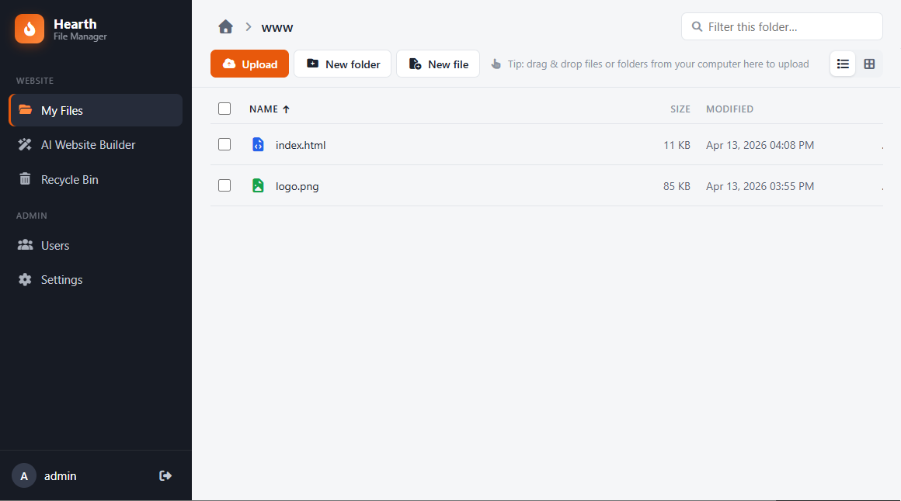

# Hearth File Manager on cshttp (proof of concept)

This folder is a **port of [Hearth File Manager](https://github.com/ASP-NET-Web-Forms-Club/Hearth-File-Manager)** to **cshttp**.
It exists to show that a real, non-trivial application can run on cshttp.

The original Hearth File Manager is an ASP.NET web application built with the **Pageless ASP.NET Web Forms Architecture**, hosted on IIS.
**This copy is no longer an ASP.NET web application.** It is a self-contained **.NET Framework 4.8 console exe** that runs its own
HTTP server (`cshttp.server`) and uses the `System.Web`-compatible API from `cshttp.web`. It does not need IIS, `System.Web` or ASP.NET.

For the real product (features, IIS deployment, updates), use the original project:
**https://github.com/ASP-NET-Web-Forms-Club/Hearth-File-Manager**



---

## What this proves

Most of the application code was copied over with almost no changes. The handlers still use `HttpContext.Current`, `Request.Form`,
`Request.Files`, `Response.Write`, `HostingEnvironment.MapPath` and so on, but those names now come from `cshttp`.

| Change | Where |
|---|---|
| `using System.Web;` / `using System.Web.Hosting;` → `using cshttp;` | one line in each of 17 files |
| `Global.asax` + `Global.asax.cs` → [`Program.cs`](HearthFileManager/Program.cs) (same routing `switch`) | 1 new file |
| Web-application `.csproj` → SDK-style console `.csproj` (`net48`, `OutputType=Exe`) | [`HearthFileManager.csproj`](HearthFileManager/HearthFileManager.csproj) |
| `web.config` request limit and custom headers → `ServerOptions` and two `AppendHeader` calls | `Program.cs` |
| Static `/css/`, `/js/`, `/assets/` (IIS served these) → three `StaticFiles.TryServe` lines | `Program.cs` |
| Unknown URLs → explicit 404 (IIS did this) | `Program.cs` |

Nothing else was changed: the `engine/` code, the `RH/` page and API handlers, and all JavaScript and CSS are the same as in the original.

The port also found a gap in cshttp: `Response.Cache.SetCacheability(...)` / `SetMaxAge(...)` did not exist.
`HttpCachePolicy` and `HttpCacheability` were added to `cshttp.web` because of this. More details are in [MIGRATION-NOTES.md](MIGRATION-NOTES.md).

---

## What the app does

The features are the same as the original:

- **File manager**: drag & drop upload of files and folders (chunked), zip / unzip, list and grid views with thumbnails,
  rename / move / copy, a built-in code editor, and a recycle bin
- **Multi-user with permissions**, and per-user root folders
- **Gemini-powered website builder**: describe a change in plain language, and Gemini edits the website files through built-in tools.
  Every AI reply can be undone

See the [original README](https://github.com/ASP-NET-Web-Forms-Club/Hearth-File-Manager) for the full feature list.

---

## Run it

Requirements: Windows with **.NET Framework 4.8**, and the .NET SDK to build.

```
cd HearthFileManager
dotnet build
bin\Debug\net48\HearthFileManager.exe
```

Then open **http://localhost:8080/** and sign in with `admin` / `admin`.
If `App_Data/config.json` doesn't exist, it is created on first start.

Command-line options:

| Option | Meaning |
|---|---|
| `--port 9000` | Listen on another port (default `8080`) |
| `--public` | Listen on all network interfaces (default: localhost only) |
| `--root <path>` | Folder that holds `App_Data`, `css`, `js` and `assets` (default: found by searching upward from the exe folder) |

Run the end-to-end tests (46 checks; starts and stops its own server instance on port `18080`):

```
powershell -ExecutionPolicy Bypass -File ..\e2e-test.ps1
```

The scripts in [`tests/`](tests) test the core engine directly, without starting the server.

> **Note:** This exe serves the **file manager only**. The managed website in `App_Data/public/` (HTML + PHP) is not served by it.
> In the original deployment that folder is a second IIS site.

---

## Folder layout

```
HearthFileManager/
  Program.cs         entry point: server options, startup code (was Application_Start), routing switch (was Application_BeginRequest)
  engine/            ApiHelper, AppConfig, AppSession, Guard, PageTemplate, FsService, StaticAsset
  engine/Ai/         GeminiAgent, AiTools, AiUndo, AiTaskManager
  RH/                page + API handlers, one per file
  js/, css/, assets/ front end (served by StaticFiles.TryServe)
  App_Data/          config, sessions, recycle bin, temp files, and the managed website in public/
packages/            the app's own dependencies (Newtonsoft.Json, System.Data.SQLite). cshttp itself has none
tests/               PowerShell scripts for the engine
e2e-test.ps1         end-to-end HTTP tests against the running exe
MIGRATION-NOTES.md   what changed during the port
DEVELOPER-NOTES.md   implementation notes carried over from the original
```

> **Security note:** `App_Data/config.json` holds password hashes and your Gemini API key. It is in `.gitignore`.
> Change the default `admin` password if you use `--public`.

---

## License

Released into the public domain under **[The Unlicense](LICENSE)**, the same as the original project.
